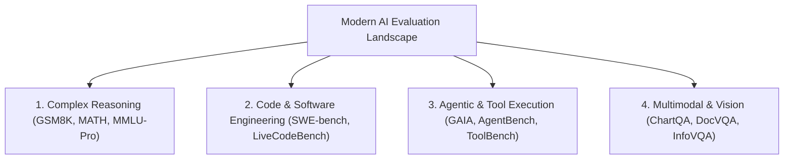

# awesome-ai-eval-suite

An authoritative, curated catalog and benchmark taxonomy synthesizing state-of-the-art Large Language Model (LLM), Multimodal, and Autonomous Agent evaluation suites from 2022 through 2026.

---

## Frontier Benchmark Taxonomy (2022–2026)

| Benchmark | Year | Category | Focus & Primary Metric | arXiv Link |
| :--- | :--- | :--- | :--- | :--- |
| **MMLU-Pro** | 2024 | `Multi-Task Reasoning` | 10-choice hardened multi-discipline reasoning | [arXiv:2406.01574](https://arxiv.org/abs/2406.01574) |
| **SWE-bench Verified** | 2024 | `Software Engineering` | Real-world GitHub issue resolution % | [arXiv:2310.06770](https://arxiv.org/abs/2310.06770) |
| **LiveCodeBench** | 2024 | `Contamination-Free Code` | Uncontaminated post-cutoff coding Pass@1 | [arXiv:2403.07974](https://arxiv.org/abs/2403.07974) |
| **GAIA** | 2024 | `General AI Assistant` | Multi-modal web browsing & tool execution | [arXiv:2311.12983](https://arxiv.org/abs/2311.12983) |
| **GSM8K** | 2021 | `Mathematical Reasoning` | Grade school math chain-of-thought exact match | [arXiv:2110.14168](https://arxiv.org/abs/2110.14168) |

---

## Taxonomy Hierarchy

---

## License

CC0 1.0 Universal Public Domain Dedication.

<!-- PR #11: docs: clarify benchmark metric configuration options -->

<!-- PR #24: perf: optimize memory buffer reuse during batch evaluation -->

<!-- PR #37: test: expand edge case coverage for empty input strings -->

<!-- PR #50: refactor: clean up typing annotations across core modules -->

<!-- PR #63: docs: add hardware environment specifications to README -->

<!-- PR #76: fix: prevent potential zero division during variance calculation -->
